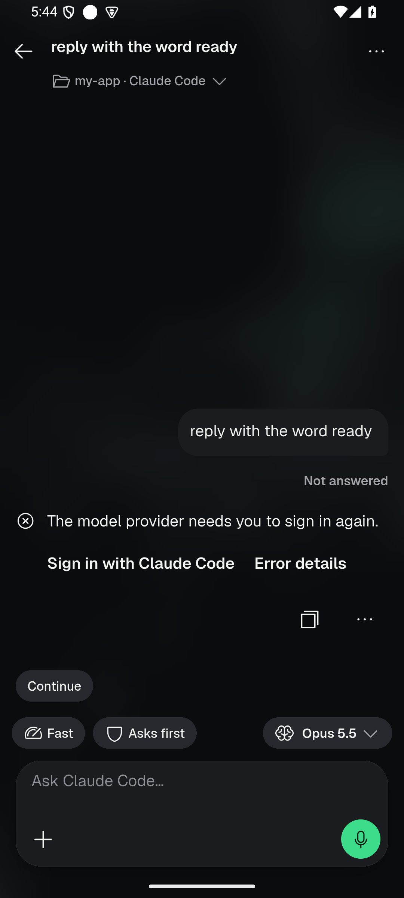
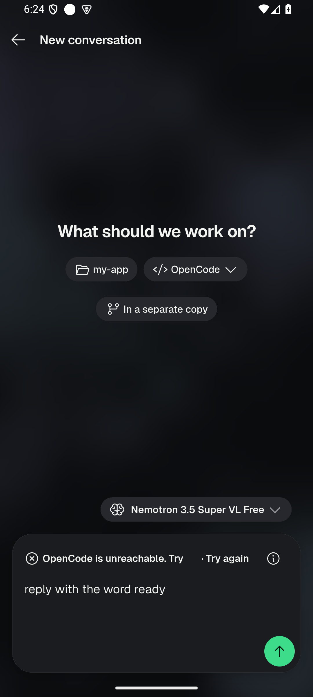
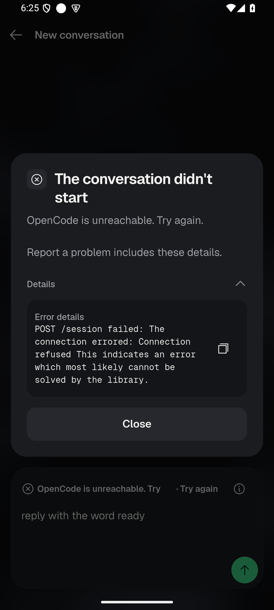
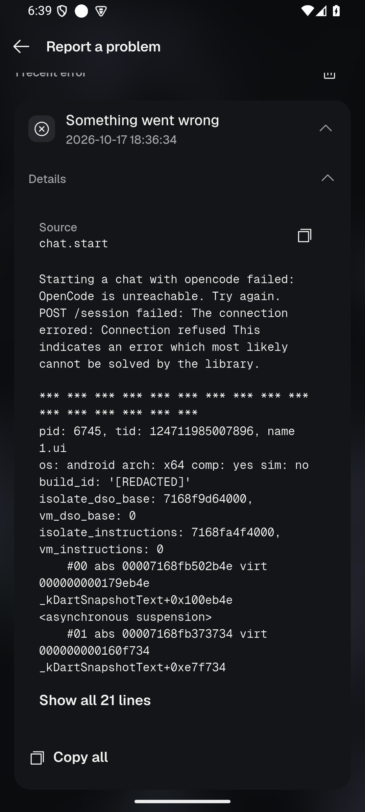

# Claude Code first message: "Could not start this chat" (2026-10-17)

Branch `fix/claude-first-message` (worktree `oc_app-ccfix`), based on
`int/ui-batch-2026-10-14` at `5e6706819`. Local commits only: nothing pushed,
signed for release or published. The owner's phone was not touched; all
device work ran on the `OC_API35` emulator (x86_64, `emulator-5554`).

**Finish line:** when starting a Claude Code chat fails, the person sees plain
words with the technical cause under Details, and Report a problem keeps it;
"Use Claude Code" in Settings › Agents opens a new conversation with it.

**Non-goal:** changing how Paseo 0.11.2 creates agents, or anything on the
owner's phone.

## What the owner saw (build 2515)

New conversation → Claude Code (Opus 5.5) → FinanceHub3 → first message →
"Could not start this chat. Refresh before trying again." on every try. Two
"New conversation · Claude Code · FinanceHub3" rows appeared (app-side drafts)
and Paseo's `agents/` folder gained no record. Claude itself answered
`claude -p` as user `oc` with the app's HOME and CLAUDE_CONFIG_DIR.

## Root cause

### Proven: the cause was thrown away, three times, on the way to the screen

Nothing on screen or in the report could say why the start failed:

1. `MergedChatFeed.startChatInSource` replaced any failure that was not
   already app copy with a new `ProductException` **without** its cause.
2. `ProductFailure.technicalDetails` printed a wrapped cause with
   `'$cause'`. For a `PaseoFailure` that is the fixed sentence "The Paseo
   daemon could not complete this action." The daemon's own sentence (its
   `reason`, e.g. "Working directory does not exist…") was dropped.
3. `PaseoGateway._withPayloadUse` turned **any** refusal from the phone host
   into a bare `PaseoFailure(unavailable)`. That included the host's own
   app-authored refusal ("Agent setup is in progress", raised while a phone
   check, an install or an agent removal runs).
4. The saved problem report is one ring of 128 entries shared by errors and
   timings, oldest out first. Linux status reads alone finish about twice a
   second, so even a recorded error was gone within a minute. On build 2521
   the report held 128 timings and no error one minute after a failed start.

### What the failing step is on the phone (narrowed, not proven)

The phone's evidence matches exactly one shape in the code. The draft is made
locally (`createSession`), then `promptAsync` fails **before** the daemon
creates anything. The ways there are:

- the host's payload gate refuses (`_beginPayloadUse`: host closed, phone
  check running, install running or agent removal running). The existing
  test `denied acquisition prevents draft create and does not release`
  produces this exact symptom: a draft, no `create_agent_request`, every
  retry the same;
- the daemon refuses `create_agent_request` before it stores an agent (a
  missing working directory, workspace or provider-snapshot refusal).

Build 2515 cannot tell these apart, because all four losses above hide the
reason. With this branch the banner's Details and Report a problem name the
gate or the daemon's sentence. The owner's next attempt on a build from this
branch settles it.

### Ruled out

- **Paseo 0.11.2 refusing what the app sends.** The pinned lock was installed
  on the PC (`npm ci`, 0.11.2) and run as the phone runs it (`paseo daemon
  run`, config.json, PASEO_* overrides). `tool/qa/paseo_first_message_live_test.dart`
  drives the app's own `PaseoChatFeedSource.startAgentChatIn` (phone gateway
  settings: `defaultProviderModes {'claude': 'default'}`, 15 s requests).
  Results: agent created with the default model, with `claude-opus-5-5`,
  and with an unknown model id.
- **A Paseo home left by 0.9.2.** The same home was used first by 0.9.2
  (agent created), then by 0.11.2: the first message created the agent.
- **A code change between builds.** Build 2492 was installed on the emulator
  with in-app Ubuntu, Paseo 0.11.2 and Claude Code 2.1.294 (the phone's
  pins). The first Claude Code message created the agent through Paseo
  (`agents/root-projects-my-app/e2794a0e-….json`) and reached Claude, which
  answered "needs you to sign in again" (the emulator has a dummy sign-in).
  `git diff c5263085c..5e6706819` (2492 → base) changes no Paseo,
  phone-agent or chat-start code.

## Fixes

| Commit | What |
| --- | --- |
| `7582928e1` | The cause rides along: merged feed keeps it; `technicalDetails` uses the cause's own details (the daemon's `reason`); the host's refusal reaches Details with the gate that refused. The new-chat banner offers Details (kit `KitComposerFailure.onDetails` → `showKitAlert` with `KitTechnicalValue`, folded). The failure is recorded in the app diagnostics as `chat.start`. English + Arabic copy. |
| `2fb05027d` | Settings › Agents: "Use Claude Code" opens New conversation with Claude Code selected. |
| `4cbdfca3e` | The problem report drops the oldest timing first; an error, exit or thermal event goes only when no timing is left. |

Kit only, no red (the failure glyph is neutral), no new bar or row level.

## Failing tests (revert the fix, watch it fail)

Pinned Flutter 3.47.1, `--concurrency=1`.

```text
test/paseo_first_message_failure_test.dart
  a host that refuses new work names its reason under Details
    Expected: contains 'Agent setup is in progress'
      Actual: 'The Paseo daemon could not complete this action.'
  a daemon that refuses the agent names its sentence under Details
    Expected: contains 'Working directory does not exist'
      Actual: 'The Paseo daemon could not complete this action.'
test/merged_chat_feed_test.dart  a failed start keeps its cause for Details
    Expected: contains 'helper went away'   Actual: <null>
test/chat_start_diagnostics_test.dart  a failed start is recorded in the app diagnostics
    Bad state: No element
test/report_problem_test.dart  a failure outlives the timings that arrive after it
    Expected: 'chat.start failed'  Actual: 'OCTRACE 1.0ms linux.status 16'
test/agents_account_ui_test.dart  Use Claude Code opens a new conversation with it chosen
    Expected: exactly one matching candidate
      Actual: Found 0 widgets with text "What should we work on?"
```

With the fixes all pass. `test/chats_new_chat_test.dart` adds the banner's
Details (cause folded in the alert, not in the banner) and no Details when a
failure has no technical cause.

Focused run of the affected files (agents UI, chats new chat, kit ratchet,
merged feed, no-raw-error, Paseo chat feed/gateway/payload use, phone agents
controller/host, redaction, the new files): **450 passed**. Report problem
files and app diagnostics screen: **48 passed**.

## Emulator proof

1. 
   Build 2492, fresh Claude Code install, project `my-app`: the agent is
   created in Paseo 0.11.2 and Claude answers (sign-in needed: dummy token).
2. 
   Build 2521: a start that fails (the in-app OpenCode server was stopped by
   PID just before Send) shows plain words, Try again and the Details mark.
3. 
   Details: the words again, "Report a problem includes these details.", and
   the technical cause under the fold.
4. 
   Build 2522, two minutes after another failed start: Report a problem
   lists it as a recent error, source `chat.start`, with the words and the
   cause. The saved report held 126 timings, 1 thermal and this error
   (on 2521 the same wait left 128 timings and no error).

The Claude Code start itself could not fail on purpose on the emulator after
the upgrade: from build 2520 on, the agent picker read Claude Code as "Sign
in needed" although `claude auth status --json` inside the same PRoot (uid
1000, profile HOME and CLAUDE_CONFIG_DIR) answered `loggedIn: true`, and the
app's own auth probe script run there printed `{"state":"signedIn"}`.
The phone check's Ready step said `Check: unavailable`. That is the native
auth bridge on this emulator's state; it is not the owner's symptom (their
picker offers Claude Code) and is left as a follow-up note. The Claude Code
path is covered by the fake-daemon tests above, which use Paseo 0.11.2's
real reply shapes.

## Still needs the owner's phone

Install a build from this branch, repeat New conversation → Claude Code →
FinanceHub3 → first message. If it still fails, tap the ⓘ on the banner:
Details names the refusing gate ("phone check running", "agent install
running", …) or the daemon's sentence. Report a problem now keeps it as a
`chat.start` entry.
