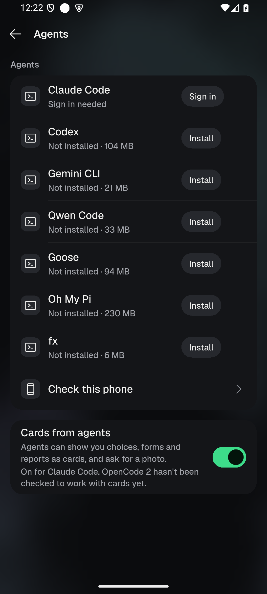
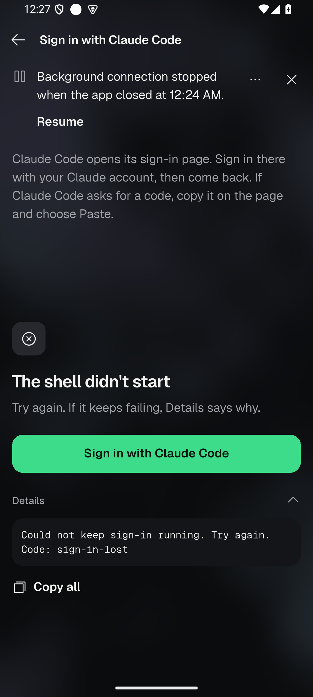
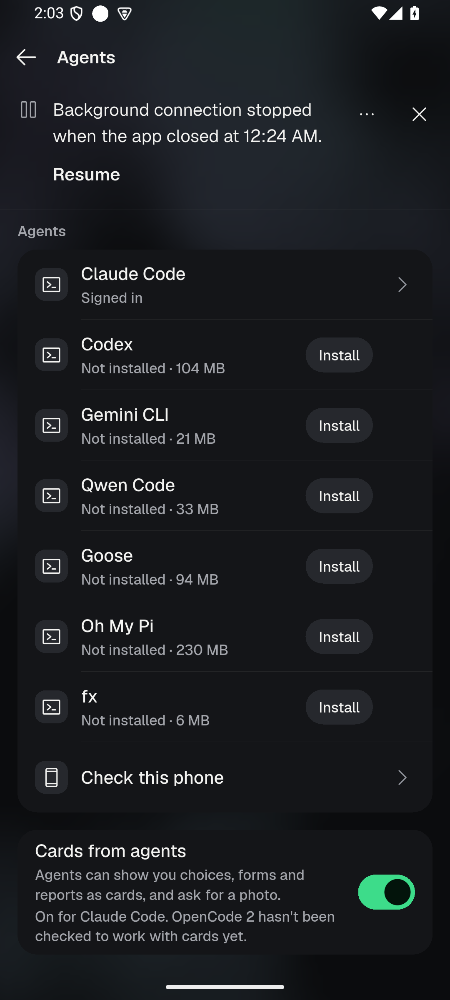
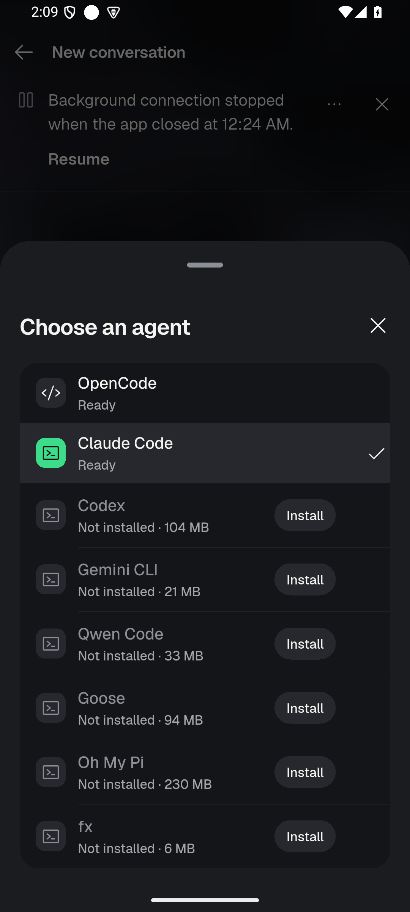
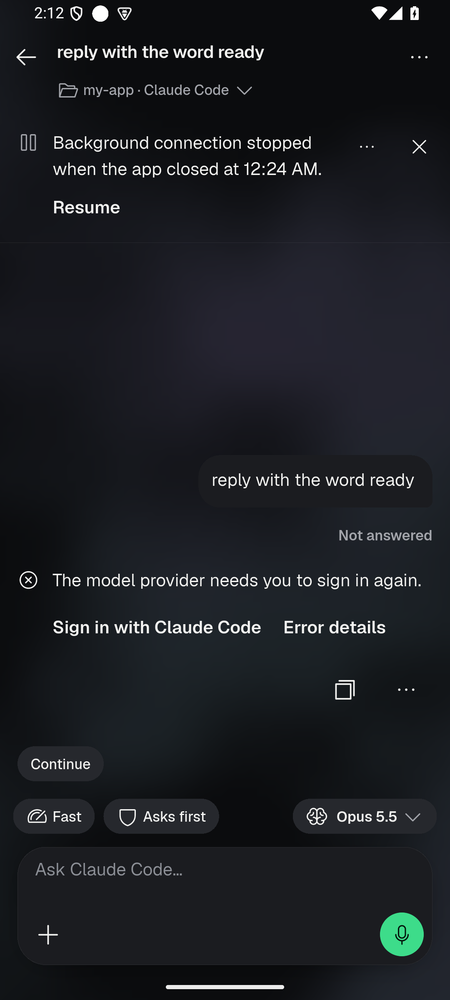
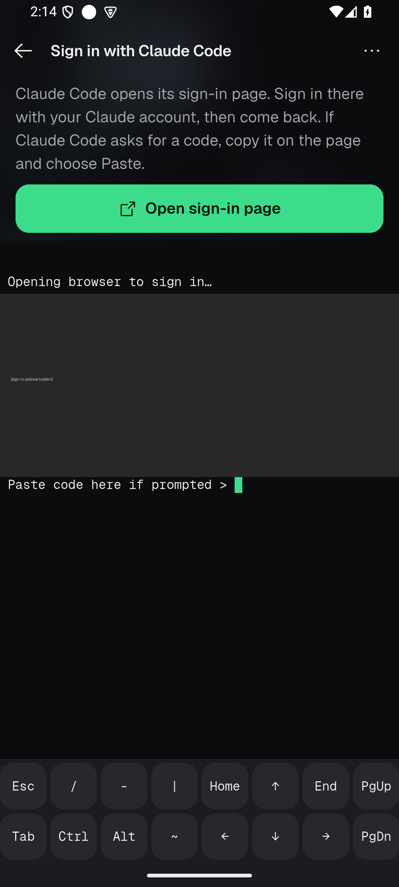

# Claude Code sign-in: wrongly required, and the terminal lost at once (2026-10-17)

Branch `fix/claude-sign-in` (worktree `oc_app-signin`), based on `513ac2838`
(build 2523). Local commits only: nothing pushed or published. The owner's
phone was not touched; device work ran on the `OC_API35` emulator (Android 15,
x86_64, `emulator-5554`).

**Finish line:** a signed-in Claude Code is never sent to sign-in; the
sign-in terminal starts and stays up on Android 15/16; any remaining failure
names its true cause under Details.

**Non-goal:** redesigning the sign-in screen.

## What the owner saw (build 2523)

New conversation → Claude Code → the app opened "Sign in with Claude Code" →
the terminal failed at once: "Could not keep sign-in running. Try again. /
Code: sign-in-lost". They may already have been signed in.

## Root cause 1: a signed-in Claude Code read as "Sign in needed"

The app asks Claude Code itself (`claude auth status --json`) through
Android's private auth bridge (`PhoneAgentAuthProbe`/`…ProcessTree`). Any read
that fails becomes `AgentSignInPhase.failed`, which the agent row turns into
"Sign in needed" with the sign-in step as its fix.

- **Proven (emulator, build 2522): the read never drained.** After the read,
  the bridge confirms that every process the read started has gone. It
  counted *every* process of the app that appeared during the read as an
  escaped child of it. The read runs up to 60 s, and at app start the
  in-app server starts its workers then (`node …/server.cjs` under
  `opencode2 serve`). The read was declared undrained, kept in the bridge's
  retired list, and every later read for that profile retried that drain
  and answered `hostUnavailable` until those workers ended. On the emulator:
  cold start → Settings › Agents › "Claude Code · Sign in needed", still so
  a minute later, while a phone check run before (server already up) said
  "Signed in". The process list showed the server workers started seconds
  after the app.
  Fix: a task started by a task that already ran before the read (the app,
  the server, a terminal) belongs to that task. An auth child that escapes
  its tree is reparented to init, outside the app's census, and still blocks.
- **Proven (code + test): two reads at once.** The bridge runs one read per
  profile and refuses a second as `hostUnavailable`. The agent list, the
  sign-in step and the phone check ask together; the phone check's read is
  the one behind the prior agent's `Check: unavailable`. Reads now take
  turns in `BuiltinPhoneAgents`, and a read asked for while the same
  agent's read runs shares its answer.
- A read that could not run (`hostUnavailable`, `timedOut`) replaced the
  agent's own last answer. It now keeps the last signed-in or signed-out
  answer.

## Root cause 2: the sign-in terminal failed at once with "sign-in-lost"

The terminal holds a temporary claim on the dataSync service
(`BackgroundConnectionService`) so Android keeps the in-app Linux alive while
the person is in the browser.

- **Proven (emulator, build 2522): a durable pause refused the service.**
  With Stay connected on, the app closing (force-stop here; on the owner's
  phone every adb install of a new build is an app update) leaves Android's
  pause receipt ("Background connection stopped when the app closed").
  The sign-in claim read that pause and refused to start the service. The
  terminal showed exactly the owner's text, `Code: sign-in-lost`
  (screenshot 02). Explicit sign-ins now start the service during a pause:
  the person asked, with the app in front, and the pause still stops live
  mode from coming back by itself.
- **Proven (test): the real refusal was masked.** The lease signalled "lost"
  even before admission. The terminal reported a bare `sign-in-lost` and
  ended the sign-in, and the refusal with its code (`paused`,
  `service-not-started`, …) was then dropped. Before admission a failure
  now goes to `ready` only and Details reads `sign-in-admission/<code>`.
  After admission a loss says what stopped the service:
  `sign-in-lost/android-time-limit`, `/paused-by-you`, `/service-gone` (a
  status read found it stopped), `/live-turned-off`, `/app-closed`,
  `/owner-closed`. Fixed codes only.
- **Hardening (not reproduced):** a refused dataSync start (Android 15+
  daily budget) threw out of `onStartCommand` and ended the app; it now
  reports `service-refused` (`service-receipt-unsaved` when the receipt
  could not be stored). The wait for Android's start receipt is 5 s instead
  of 2 s, so a busy phone does not report a start as failed and leave the
  service running unowned.

### The first message and the phone check

The phone check holds `_checkInFlight`, which also refuses a first message
("phone check running", named under Details since build 2523). Checks run
only when the person starts one, and the hold is released in `finally`:
it cannot stay stuck; it lasts as long as the check (install, version,
connection, then one sign-in read of at most 65 s). A refused second read
inside the check made it fail ("Check: unavailable"), not hang. Reads now
take turns, so that failure is gone. No other link to the first-message
failure was found.

## Tests (fail with the fix reverted, pass with it)

Pinned Flutter 3.47.1, `--concurrency=1`.

```text
test/phone_agent_auth_native_test.dart  tree-new-task-from-earlier-owner
  (kotlinc harness) A task started by an earlier owner kept the probe from draining
test/phone_agents_host_test.dart  status checks asked at once take turns …
  Expected: every element(signedIn)  Which: has value error at index 1
test/phone_agents_controller_test.dart  a check that could not run keeps a signed-in agent signed in
  Expected: true  Actual: <false>  (hostUnavailable)
test/sign_in_foreground_causes_test.dart (real BackgroundLiveController + terminal)
  a service Android did not start is named, not called lost
    Expected: 'Code: sign-in-admission/service-not-started'  Actual: 'Code: sign-in-lost'
  a durable pause does not stop a sign-in the person asked for
    Expected: running  Actual: failed
  a running sign-in says what stopped its service
    Expected: ends with 'Code: sign-in-lost/android-time-limit'  Actual: 'Code: sign-in-lost'
```

`test/agent_sign_in_foreground_test.dart` adds that a coded refusal and a
coded loss survive the owner binding. Existing tests were updated where they
asserted the old behaviour (a durable pause refusing a sign-in; a bare
`sign-in-admission`).

Focused run (77 files: phone agents, agent sign-in, agents UI, local
terminal, background, Paseo, new chat): **1122 passed, 1 skipped**.
`tool/qa/preflight.sh int/ui-batch-2026-10-14`: **OK** (commit rules,
format, l10n, analyze clean, QA tools 793, repo-scanning 162).

## Emulator proof

Release APK `build/vps-apk/app-release-2530.apk`, built with
`tool/qa/vps_build_apk.sh 2530 --split-debug-info`, signer
`1DE5BF08146F269BCD9EB5C2FFC94469CE4617D37806285955F978A62494D60C`.

1. 
   Build 2522, cold start: Claude Code (signed in) reads "Sign in needed".
2. 
   Build 2522 with a durable pause (banner at the top): Sign in again →
   "The shell didn't start", Details "Code: sign-in-lost", the owner's text.
3. 
   Build 2530 installed over 2522 (same data, same durable pause), cold
   start: "Claude Code · Signed in". Four cold starts in a row (force-stop,
   launch, Settings › Agents after 75–90 s): Signed in each time.
4. 
   New conversation → agent picker: Claude Code is Ready; choosing it goes
   straight back to the composer with Claude Code chosen, no sign-in step.
5. 
   First message "reply with the word ready": the conversation is created
   and Claude Code answers. Its answer asks to sign in again because this
   emulator holds a dummy Claude token (its `auth status` says signed in;
   the API refuses the token); that is Claude's own reply after the
   message was sent, not an app detour.
6. 
   "Sign in with Claude Code" from that reply, with the durable pause still
   on: the terminal runs `claude auth login`, the app opened Claude's page
   in the browser, and `dumpsys` showed `BackgroundConnectionService`
   foreground with type dataSync. Still running after more than a minute;
   leaving the screen released the service. The sign-in address is hidden
   in the image.

## Not proven

- The owner's phone was not touched. That the owner's pause came from an
  app update (they install builds over adb while Stay connected is on) is
  inferred from their dumpsys (service not running, live mode probably off)
  and from the emulator reproducing their exact text; with this build,
  Details names the cause if anything else refuses the service.
- The refused-start path (`service-refused`, Android 15+ dataSync budget
  spent) is covered by tests and code reading only; it could not be forced
  on the emulator.
- Android 16 was not run; the emulator image is Android 15.

## Machine use

At the coordinator's order (owner: the PC was too loud) the emulator was
shut down by exact PID at 00:35 and no local Flutter test, build or Gradle
ran until 02:00. The tests and preflight above ran locally before that order;
the APK was built on the build server. The proof above ran after 02:00.
